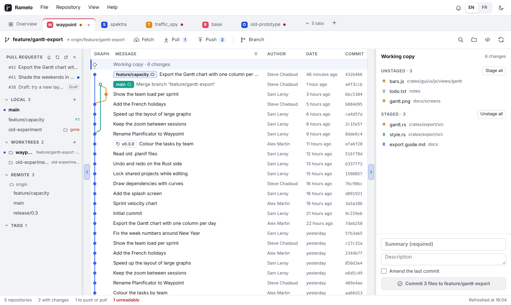
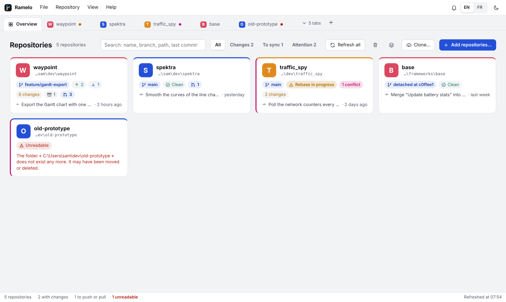

<p align="center"></p>

<h1 align="center">Ramelo</h1>

Ramelo is a desktop git client for people who work with many repositories at once. It automates
the tedious parts of git so that everyday work stays fast: rewording, reordering, squashing or
fixing up a past commit takes one click, with no interactive rebase to drive by hand. It also
understands workspaces managed by Google's `repo` tool (git-repo).

Ramelo runs on Windows and Linux (macOS later), in English or French, with a light or dark theme.





## Features

### Workspace

- Add repositories from a folder dialog or by dropping folders onto the window. A folder that is
  not a repository is searched for the repositories it contains (a folder of projects, a git-repo
  workspace…).
- One tab per repository, plus an overview. Tabs are reordered by dragging, pinned, closed one by
  one or in groups, and remembered between sessions. When they no longer fit, a list finds one by
  name or path (Ctrl+Shift+A).
- The overview shows every repository at a glance: branch, commits to push or pull, changes,
  conflicts, operation in progress, stashes and last commit. It can be searched, filtered (changes,
  to sync, needs attention) and organised in sections that fold and are reordered by dragging.
- Each repository can be given its own colour, used for its tab, its card and its avatar.
- Every repository is read again when the window regains focus, and its remotes are fetched in the
  background (every 10 minutes by default, set in Settings). A background fetch never asks for a
  password and stays silent when it fails.

### History and diffs

- A commit graph of every branch, remote branch and tag, with the working copy on top. Selecting a
  commit shows its message, author and files; selecting a file shows its diff, in one column or side
  by side.
- Search the whole history (Ctrl+F) by message, author, commit id, changed file or changed code,
  with case matching and regular expressions.
- Images are compared before and after; Markdown and HTML files switch between their diff and a
  formatted preview (HTML is rendered in a sandbox where scripts never run).
- The side panels and the diff panel are resized, folded (Alt+1 to Alt+4) and remembered.

### Changes and branches

- Stage by file or by hunk, discard changes, commit and amend. With nothing staged, the commit
  button stages everything.
- Branches: create one from any commit, switch with a double click (local changes can come along),
  delete. A remote branch is checked out as a detached HEAD, or as a local tracking branch from its
  menu.
- Worktrees: list, create (on a new or an existing branch) and remove them from the side panel. A
  tab shows one worktree at a time, and switching to another keeps the same tab.
- Fetch, pull and push in one click. Pull fast-forwards when it can and otherwise asks between
  rebase and merge; push sets the upstream on the first push and offers to pull first or to force
  with lease when it is rejected. From the menu of a commit, a branch is pushed only up to that
  commit, the later ones staying local.
- Commits are exported as `.patch` files, and patches applied back (`git am` or `git apply`).

### Rewriting history without an interactive rebase

- Reword a past commit, or edit one of its files: the commits after it are written again and the
  working copy follows. A conflict with a later commit leaves everything as it was.
- Move a commit up or down (Alt+Up, Alt+Down).
- Squash or fixup a commit into the one before it, or several marked commits together.
- For a commit already pushed, Ramelo says which remote branches have it and that a force push
  (with lease) will be needed.

### Conflicts

- A merge, rebase, cherry-pick or revert that stops on conflicts shows a banner to continue, skip or
  abort it.
- A conflicted file opens in a conflict editor: both sides next to each other, each conflict settled
  in one click, and the resulting file below, which can still be edited by hand.

### Remotes and hosting services

- Clone from an address, with progress and the option to stop; several repositories can be cloned
  together.
- The first connection to an ssh server shows its keys and fingerprints and asks whether to trust
  it, as ssh does in a terminal. A server whose key changed is never trusted this way.
- Accounts on GitHub (github.com or Enterprise), GitLab (gitlab.com or self-hosted), Bitbucket Cloud
  and Bitbucket Data Center. Tokens are checked with the service and kept in the system's credential
  store, never in a file.
- Find a repository on an account and clone it over HTTPS or SSH.
- Pull requests (merge requests on GitLab): listed per repository and counted on the overview,
  opened with their description, comments, changes and commits, commented line by line, merged or
  closed. New pull requests are opened from Ramelo, and watched repositories notify new pull
  requests and comments.

## Roadmap

1. Multi-repository workspace (done).
2. Repository view: graph, diffs, staging, commits, branches, fetch / pull / push (done).
3. Automation: reword, edit, move, squash and fixup without an interactive rebase, conflict
   resolution (done); undo based on the reflog (to come).
4. git-repo: manifest detection, `repo sync`, `repo start` and a global status of all projects.

## Architecture

| Folder | Role |
| --- | --- |
| `crates/core` | Runs git and reads repositories: status, history and graph layout, diffs, staging and commits, branches, worktrees, remotes, history search, cloning, repository discovery. No dependency on the interface or the storage. |
| `crates/storage` | The workspace (`workspace.json` in the user's data folder) and the accounts on hosting services (`accounts.json`, without their tokens), written atomically. |
| `crates/hosting` | Hosting services through their web API (GitHub, GitLab, Bitbucket): accounts, repository search, pull requests, and their tokens in the system's credential store. |
| `crates/gui` | Tauri 2 application: the commands called by the interface (`src/commands`). |
| `crates/gui/ui` | Interface in HTML, CSS and JavaScript (ES modules, no framework, no bundler). |
| `crates/gui/ui/vendor` | Third-party code, kept as published: [marked](https://github.com/markedjs/marked) (MIT) for Markdown. |

The Rust side is the single source of truth: each command returns a snapshot of the repositories
that the interface displays without computing anything itself.

Every git operation goes through the `git` command line rather than a library, so Ramelo behaves
exactly like the user's own git: same configuration, credentials, hooks and worktrees. Git calls
never open a console window on Windows, never wait for a prompt, and never take the index lock when
they only read.

## Download

Installers for Windows (`.exe`, `.msi`) and Linux (`.AppImage`, `.deb`, `.rpm`) are attached to each
[release](https://github.com/SteveChd/Ramelo/releases).

## Build and run

Requirements:

- Git on the PATH (Git for Windows on Windows).
- Rust (stable) and the Tauri 2 prerequisites: WebView2 on Windows (already present on Windows
  10/11); `libwebkit2gtk-4.1-dev`, `libgtk-3-dev` and `librsvg2-dev` on Linux.

```sh
cargo run -p ramelo         # the application
cargo test --workspace      # the tests (they create temporary repositories with git)
```

The interface can be previewed in a browser without Rust: serve `crates/gui/ui` with any static
server (for example `python -m http.server 5179 --directory crates/gui/ui`). A fake backend with
sample repositories takes over (`ui/js/api/mock`).

On some Linux machines (virtual machines, some GPU drivers) WebKitGTK shows a blank window; starting
the application with `WEBKIT_DISABLE_DMABUF_RENDERER=1` fixes it.

## Releasing

1. Set the new version in `Cargo.toml` (`[workspace.package]`) and `crates/gui/tauri.conf.json`,
   commit and push.
2. Tag that commit and push the tag: `git tag v1.1.0 && git push origin v1.1.0`.
3. The Release workflow builds the installers and attaches them to a draft release of that name;
   publish it from the Releases page of GitHub once it looks right.

## License

Ramelo is released under the [MIT License](LICENSE).
